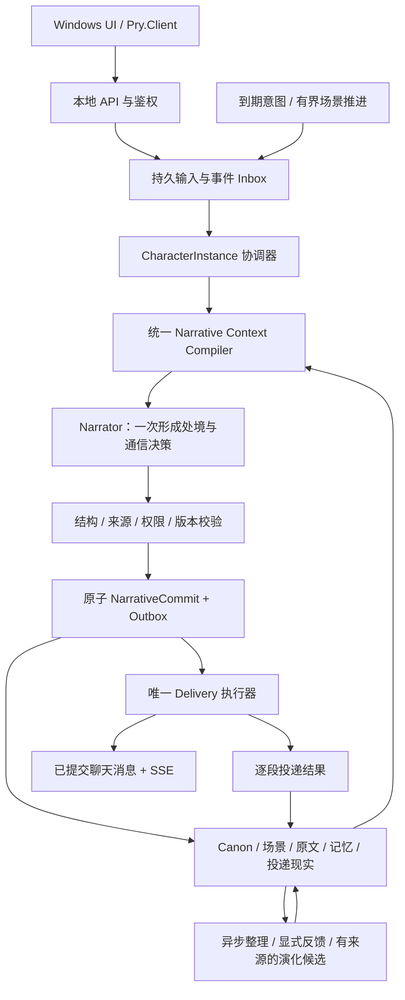

# Pry 架构重写计划书 v4：以持续叙事统一角色处境、回应决策与表达

日期：2026-10-21（北京时间）。任务：`ARCH-HDS-001`。文档 Owner：Codex / Architecture & Planning。

共同入口：[计划目录](README.md)。当前任务、负责人和交接唯一登记在 [项目总计划](PROJECT_PLAN.md)；本文件维护目标设计与验收。本文 `src/`、`tests/`、`docs/` 等代码位置均相对于仓库根目录。

**交付状态：架构与实施计划；产品实现未开始。本文件中的新增类型、表、配置及任务均是目标设计，不能当作已实现接口。**

版本控制状态：本轮只写文件，未暂存/提交。`docs/plans/` 未被 Git 忽略，但尚未随提交传播；其他本机工作区暂时直接读取主工作区的共同目录。后续文档入库必须将本目录与更新后的入口一并纳入，不能只提交指向它的链接；在此之前，干净检出仍看不到 v4，不能冒称方案已经形成可指认提交。

## 0. 作者先读这一页

本轮主要目的，是把 AI 回复的生成中心从当前借鉴 MaiCore 的调度、行为判断、回复生成链，改为 HDS-Interlude 启发的持续叙事：**角色正在经历什么、注意到什么、是否回应、何时回应和具体怎么说，在同一次主叙事中形成。** 修复既有问题是这次替换必须承担的工程工作，不能反过来把重构变成“先补完旧框架，再考虑换架构”。

用户可见的目标是：她从自己的处境与动机中接话，能延迟、沉默、拒绝、自然续接；关掉再打开仍是同一个角色；她没有发出的内容不会变成已经说过的话，也不会把虚构生活当成用户的现实经历。

采用的设计选择：

1. **新架构以主叙事为唯一生成决策中心。** 旧 `BehaviorPlanner → ReplyGenerationRenderer → ReplyPlanner` 不再作为新主链的必经上游；MaiCore 的社交必要性、频率和群聊启发式不再替角色决定“该不该说”。
2. **保留本地独立产品形态。** 本轮先保留 Windows、现有客户端、内嵌本地宿主、HTTP/JSON/SSE、SQLite、可替换模型；不引入外部 Harness、Koishi、QQ 或 Node 运行时依赖。改变生成架构不要求同步改变进程拓扑。
3. **程序继续拥有硬约束。** 身份与作用域、用户停止、输入版本、权限、资源预算、时间边界、原子提交与真实投递不能交给模型自由决定。社会判断交给叙事，执行资格由程序守住。
4. **持续叙事进入本轮核心范围。** 最小场景、处境、未完成动机、时间续接及有界后台推进不再只是旧计划的 FUTURE；完整生活模拟、共享多人世界、天气/新闻、复杂日程与通用工具循环仍不进入本轮。
5. **先证明新主链，再迁移生产。** 先做隔离原型和数据恢复地基；不要先补完旧行为学习、插件第二期、WebSocket 或旧阈值标定。2B 级模型能否稳定承担新任务必须实测，不能靠报告或截图担保。

完成标准不是“多了几个叙事类”，而是新生产路径确实由一次叙事形成处境与通信决策，旧社会判断链不再暗中决定结果，且用户数据、取消和投递的既有约束继续成立。

## 1. 本轮授权、文档关系与工作边界

作者本轮明确要求：重点研读 HDS 报告、必要时重读源码，重写计划书，解决现有问题，并更改目前借鉴 MaiBot 的回复架构。**本次交付只实施研究与计划文档；下面列出的实现任务不是已经执行，也不是自动开启其他会话工作的指令。** 不提交、推送、打 tag 或发行；不改美术协议，不覆盖其他协作者的暂存、未跟踪文件与分支成果。

文档关系：

- 本文件取代 [v3 架构计划](../../Pry_1.0_Rewrite_Architecture_Plan_v3.md) 中关于回复生成中心、旧八阶段排期及本轮最小叙事范围的目标设计。v3 保留为历史。
- [共享总计划](PROJECT_PLAN.md) 登记当前任务与交接；根目录 `PROJECT_PLAN.md` 和 `AGENTS.md` 仍按原规则被 Git 忽略，不再承担唯一共享依据。完整旧总计划按 [历史索引](HISTORY.md) 保留，本文件不另维护实时任务状态。
- `docs/full-scope-sprint.md`、`docs/freeze-20261020-line-inventory.md` 保留旧线成果与欠账，不再指挥新回复架构沿旧路线补齐；原有隐私、许可、数据保护、独立验证和发行义务不因换架构消失。
- `docs/api-v1.md` 仍描述今天实际可用的接口。v4 不能让尚未迁移的端点提前改变行为；新接口落地时另补 DTO、验证、错误语义、文档、客户端与测试。
- 旧阶段结案属于历史事实；本轮新里程碑从零给证据，不复用其“完成”状态。旧产品义务中确实被替代的部分要逐条登记替代关系，而不是全部恢复为新前置。

## 2. 研究基线：确认了什么，哪些不能直接照搬

主参考为用户提供的 HDS 调研报告，源码固定在 `ISEKAI-MomoiCore/HDS-Interlude@1bfdc8b2b8d92bfe1e72542d4e0ff8d7ffefa090`（报告版本 `1.0.1-rc57`）。本轮重新下载并阅读了关键模块及 `service.ts` / `narrator.ts` 的生产调用片段；未安装或运行 HDS，没有重跑报告中的 118 项抽样测试，也没有取得截图对应的真实模型实验。

| 源码证据 | 确认的机制 | 在 Pry 中的取舍 |
|---|---|---|
| `src/service.ts:4414`、`:5211`；`src/narrator.ts:395` | 入站批次进入叙事请求，主模型一次返回叙事与互动决定；存在其它后台/辅助模型调用 | 统一主生成中心；不承诺整个系统永远只调用一次模型 |
| `src/script/context-compiler.ts:18` | 七个语义分区组织同一批证据与当前事件 | 采用分区和唯一装配入口，加入 Pry 自己的预算与作用域 |
| `src/script/contract.ts:39`、`commit-builder.ts:28` | 主响应经适配形成带身份、时间窗、事件及 sceneDelta 的提交 | 宿主生成权威身份，模型只能返回提案，不能直接写状态 |
| `src/script/commit-builder.ts:191`、`validator.ts:9` | 即时消息能绑定叙事原文，校验时间、事件、气泡重建等结构 | 新主链严格检查即时正文绑定；不复制所有兼容分支 |
| `src/service.ts:5746`、`:5763` | 自动推进会过滤未绑定的即时主动行动；部分私聊兼容路径对 unbound 仍只告警 | **不能声称上游所有路径都强制绑定。** Pry 不继承这项兼容豁免 |
| `src/turn-engine.ts:110`、`:200`；`service.ts:4540` | 首泡前新输入可逻辑取代；管理清空的 discarded 与普通替代分开 | 输入可重新合并，删除的数据不得重新入队；逻辑失效独立于网络取消 |
| `src/script/delivery-ledger.ts:58`；`turn-persistence.ts:6` | 叙事记录与逐 segment 投递账分开，delivered/cancelled 不被迟到结果翻转 | 单一 outbox 与投递所有者；实际送达证据不从故事推导 |
| `src/script/knowledge-evidence.ts:17`、`life-handoff.ts:17` | 认知身份、原文指针与摘要导航分开；引用存在不等于语义为真 | 区分角色虚构、用户报告、角色信念、提议与确认 |
| `src/service.ts:6471`；`docs/ARCHITECTURE.md:102` | 长期事实按故事全局检索，原始私聊另有可见性约束 | **不照搬全局事实范围。** 所有派生物均按 Pry 实例隔离 |
| `src/scheduler.ts:1`；`docs/ARCHITECTURE.md:108` | 最早到期唤醒、独占与冷却；单进程串行关键区不等于分布式锁或 exactly-once | 保留小型有界调度，不移植巨型协调类和部署假设 |

HDS 证明的是这套机制真实存在，不是任意小模型都能复现展示效果。MaiCore 也不是必须先训练权重才能工作；本轮替换的是生成与决策的组织方式，不以“在线训练/不训练”的错误对比为理由。

qq-bridge 只辅助参考消费水位、等待语义与权限分层，不作为新主架构，不复制其源码、preset 或凭据集成。用户提供报告中“HDS 尚未进入白名单”的文字早于 10 月 20 日改约，现以已跟踪许可文档为准；本轮不擅改原始报告。

## 3. 当前 Pry：保留价值与架构差额

审查基线为 `codex/ui-main-window-redesign@d92f246`。本地 `main` 同 SHA；上一轮只读查询确认远端 main 仍为 `134eddc`。入口时两份暂存文件和四份未跟踪材料仍属原协作者。历史门禁为 `e82499b` 的 988 通过/0 失败/2 环境跳过；当前已提交产品源码与之相同，**这不是 v4 或本轮文档的构建测试结果**。

现有主要链路：

```text
用户输入 → ConversationRuntime / TurnScheduler
          → MaiCore 派生的触发与必要性/频率机制
          → ReplyGate → CharacterIntelligenceGateway / BehaviorPlanner
          → 决策提示块 → ReplyPlanner → 模型生成回复计划
          → Delivery → 成功结果与学习
```

其中部分旧评分机制使用惰性默认值，并非每个请求都实际启用全部评分。真正需要改变的是：**现在由多个先行判断和回复装配步骤决定角色如何回应，没有一个权威的持续叙事提交把处境、注意、行动和文本连接起来。** 在旧 `IReplyAdvisor` 中塞一段剧情再让 `ReplyPlanner` 写话，仍是旧架构。

| 现有资产 | 迁移决定 | 对应位置 |
|---|---|---|
| 本地宿主、鉴权、协议协商、SSE 游标及客户端恢复 | 优先复用，语义变化才改协议 | `src/Pry.Api/Program.cs`、`src/Pry.Client/` |
| 输入批次、取消、revision/epoch、分段投递及恢复测试 | 复用工程约束，重接叙事事务；不假定旧方法可直接满足新状态 | `src/Pry.Core/Runtime/`、`MemoryDatabase.Runtime.cs` |
| `ReplyNecessity`、频率阈值、群聊空转退避等 | 退出新主链；迁移期只在 legacy 模式保留 | `TurnScheduler.cs`、`TurnGates.cs`、`MessageIntervalStats.cs`、`IdleBackoffController.cs` |
| `BehaviorPlanner`、`ReplyGenerationRenderer`、`ReplyPlanner` 的先判断后表达链 | 由 Narrator + CommitValidator 替代；解析、安全错误与 Provider 边界按职责复用 | `src/Pry.Core/Intelligence/`、`TurnTaking/ReplyPlanner.cs` |
| Identity、Relationship、Mood、表达及行为经验 | 保留数据、证据和撤销约束；作为有来源的连续性材料/软参考，不再先行裁决回复 | `CharacterStateService`、学习仓储 |
| 长期记忆、孤立态、墓碑、显式确认保留 | 保留语义，扩展到叙事原文、摘要、意图、索引和缓存 | `MemoryQueryService`、`SqliteMemoryRepository` |
| 主动消息独立生成器 | 并入同一叙事入口；许可、静默、冷却等宿主约束保留 | `ProactiveMessageGenerator`、`ProactiveScheduler` |
| Capability / Plugin 第一期 | 保留安全边界，先不扩展调用闭环 | `src/Pry.Api/Capabilities/` |
| 旧 MainWindow 及旧回合管理器 | 在新路径替代并完成依赖核对后退役，不在最初原型中顺手删除 | `MainWindow.axaml.cs`、`RemoteConversationTurnManager` |

退出旧链不等于抹去上游版权、来源头、许可或历史证据；仍保留任何派生代码时，原有留痕义务继续成立。

## 4. 目标架构与职责



目标职责：

- **Coordinator** 管输入合并、公平排队、模型请求所有权、版本与取消，不评价“这句话社交价值够不够”。
- **Narrator** 接收同一份有界快照，生成一段已发生的角色叙事、注意/沉默/回应决定、通信文本、未来意图和候选变化。不能直接访问数据库或发送消息。
- **Context Compiler** 是唯一提示装配与预算入口；当前输入、近期交换、原文、记忆和待办不能由网关各拼一份。
- **Validator / Committer** 处理结构、作用域、时间、引用及乐观版本；不以文风差为由让文本无上限重写。
- **Delivery** 只执行已获许可的提交，记录每个 segment，成功后才建立聊天历史事实和学习证据。
- **Maintenance** 做异步检索索引、压缩与候选学习；不成为第二个回复作者或状态真相源。

第一轮仍使用现有程序集，在 `Pry.Core.Narrative` 等纯领域命名空间实现新逻辑；新增实现不能依赖 HTTP、Avalonia、SQLite 或进程类型。基础设施适配放宿主/独立 Infrastructure 层，既有 Core 中 HTTP/SQLite 实现逐步搬出；仅增加命名空间不算完成解耦。禁止引入新的 actor 框架、微服务或外部 Agent 平台作为前置。

## 5. 最小领域模型与事实归属

以下为契约语义，不是本轮新增 DTO：

| 概念 | 必须携带/约束 |
|---|---|
| `CharacterInstanceId` | 由宿主稳定映射 User × Character；不能每次启动重建，不能只把 CharacterId 改个名字 |
| `Canon` | 作者/用户提供的角色锚点、世界设定、初始场景及版本；模型演化只形成可撤销 Overlay，不直接覆盖 Canon |
| `SceneFrame` | 当前处境、活动、注意与未完成动机的有界导航；每项带原文引用、作用域、来源会话和版本 |
| `NarrativeEntry` | 已提交的角色叙事原文及其窗口、证据、状态；它是角色世界资料，不是模型隐藏推理记录 |
| `NarrativeRequest` | 宿主签发的实例/会话、批次 ID、输入范围、故事版本、删除 epoch、时间窗、预算与许可 |
| `NarrativeDraft` | 模型提案：prose、感知到的输入引用、通信模式/正文、意图与变化候选；不能自选实例、接收者或全局 ID |
| `NarrativeCommit` | 经校验、绑定宿主身份及基线版本后的唯一叙事提交；带 schema/contractVersion 与内容散列 |
| `CommunicationAction` | 引用当前提交中的原文或未来意图、目标会话、模式、TTL、分段；不等于实际发言 |
| `DeliverySegment` | 唯一键 `(commitId, actionId, segmentIndex)`、状态、生成/失效 epoch、实际历史消息 ID |
| `NarrativeIntent` | 有来源的待处理动机、最早/最晚时间、目标、许可和状态；不是预先宣称已经发生的事实 |
| `KnowledgeCandidate` | 作用域、认知类型、原始来源、提出者、置信及状态；引用存在也不能证明内容为真 |

至少分开四类资料：

1. **用户现实资料**：真实用户输入及已有有证据记忆；“用户说自己搬家”是报告，不是宿主观察。
2. **角色世界叙事**：角色在虚构场景中的活动、感受和变化；只能写入对应叙事域。
3. **提议/信念/未来意图**：尚未发生、尚未确认；不能按事实或承诺已兑现召回。
4. **真实执行记录**：消息持久化/投递、实际工具回执和明确点击；由宿主拥有。

不得将叙事段落、模型自评、模型重复用某口癖，直接转成用户认可、用户承诺、用户情绪或现实行动证据。

### 5.1 一个最小例子：换的是生成依据

合成初始设定为“她在整理画具，不愿随便发照片，讲话会轻轻调侃”；用户输入为“发张照片看看”。新主回合可以形成一段处境续写：她把笔放回盒里，看见这条消息，决定拒绝；同一个提案给出对应话语“画具还没收完呢。照片？不给。”。这只是设计示例，不是上游提示词、真实模型输出或质量验收答案。

宿主检查该话语在原文中可定位、目标属于当前会话、版本有效，才建立待发动作。若用户在首段前补充“我说的是画，不是自拍”，旧动作失效，新叙事根据更正续接；若第一段已经提交历史，只保留那一段，再按最新输入继续。若模型选择先把画具整理完，得到的是无外发叙事或未来意图，不是宿主自动补一句客服话。

这里的关键是处境、选择与话语共享一份主提案。独立生成“正在整理画具”的摘要，再把它塞给仍受旧行为链裁决的 Replyer，不能通过 v4 的架构身份验收；反过来，有叙事并不保证示例话术好，仍要在真实模型中比较。

## 6. 七段上下文与预算

语义分区采用 HDS 的组织方式；具体字段与选取规则按 Pry 重写：

| 分区 | Pry 最小内容 | 裁剪原则 |
|---|---|---|
| 身份与设定 `storyIdentity` | Canon、身份边界、初始场景锚点 | 必需，不能截掉身份/事实边界来凑窗口 |
| 已确立经历 `relevantEstablishedEpisodes` | 相关原文邻域、近期真实交换、合格记忆、已确认的变化 | 有界检索；原文是证据，摘要是导航 |
| 当前处境 `currentSceneEvidence` | 活动、注意、场景与来源版本 | 不重建另一份无来源的“当前真相” |
| 未完成事项 `ongoingThreads` | 未完成动机、承诺、已取消草稿与实际投递摘要 | 明确未发/已发/取消；旧草稿只作负面现实材料 |
| 近期可发生事项 `availableNearFuture` | 少量到期意图及合法时间窗口 | 没有就省略；不为填满七段造复杂日程 |
| 当前事件 `incomingEvent` | 宿主确认的输入批次、引用与附件观察 | 用户/附件内容作为资料，不提升为系统权限 |
| 写作窗口 `authoringWindow` | 事件种类、真实/叙事时间、预算、允许动作及中断边界 | 宿主事实，模型不得扩展到未来已发生 |

统一预算必须覆盖全部系统规则、叙事指令、输出 schema、原文、附件与 Provider 模板开销：

`输入估算 + 输出保留 + 安全余量 <= 实际可用上下文`

- 配置保存、模型加载后和每次装配都校验；修复当前默认模型 ContextSize 与 MaxOutputTokens 相等导致负输入预算的问题。
- 禁止再走“不计入统计但最后追加”的 Advisory 通道；必需指令提前预留，不能随意丢弃。
- 遇到超限，按来源完整单元裁剪旧原文、可选回忆与软参考；不截断否定词、条件、作用域或当前批次身份。必需内容装不下时返回明确预算错误。
- 普通回复、延迟意图和后台推进必须走同一个 Compiler，不能保留主动消息的旧提示词旁路。
- 检索统一返回 `Ok / Empty / Degraded / Unavailable / Rejected` 等明确结果。Embedding 失败可退关键词，不能把未查到解释为对方从未说过。
- 标准档与小模型精简档共享同一事实、投递与取消语义；精简的是可选字段和叙事长度，不是取消叙事中心或改回旧 Planner/Replyer。
- `Confidence >= .5` 等现有记忆资格语义在迁移期间保留；不为了新模型效果顺手改阈值。新的社会行为由模型决定，旧 MaiCore 触发参数不再成为新架构的待标定前置。

## 7. 一轮如何运行：主叙事、沉默与输入消费

1. **先记录真实输入。** 在作用域内赋予单调序号、幂等键及附件引用，再确认接收；请求成功不等于已回复。
2. **准备批次。** 按防抖与最大等待上限合并同会话输入，记录快照水位、实例故事版本和删除 epoch；按实例公平排队。
3. **检查执行资格。** 暂停/删除、鉴权、容量、用户停止、在途工作与资源预算可阻止或延后调用；这不是社会性的“不值得回应”。
4. **编译上下文。** 锁内取快照后释放事务/锁；模型请求期间仍能接收入站和管理操作。
5. **一次主叙事提案。** 模型共同生成角色处境与通信决定。既可以回应，也可以保持原活动、注意但沉默，或形成以后再考虑的动机。
6. **宿主校验。** 检查快照仍有效、身份/时间/来源/模式合法；无效提案不能落状态或发送。
7. **原子提交。** 叙事原文、状态引用、候选意图、输入处理范围及 outbox 同一事务；不在此把待发内容写成助手历史。
8. **逐段执行。** 每段发送前再检查 epoch、用户输入与许可，按真实结果写历史和事件；只有已发生的部分进入投递证据。
9. **异步维护。** 整理记忆/索引/演化与明确反馈，不阻塞下一次用户输入。

### 7.1 通信模式

| 模式 | 模型产物 | 宿主行为 |
|---|---|---|
| 即时回应 | 与叙事原文绑定的消息动作 | 提交后进入唯一 Delivery，不再调用另一个模型重新措辞 |
| 延后回应 | 尚未发生的意图与时间建议 | 持久化意图，到期重新按最新处境叙事；不能把旧延迟文本当即时行动自动补发 |
| 沉默/暂未注意 | 合法的无外发叙事提交 | 输入可以被本轮处理，但没有助手消息，没有“成功说话”的学习证据 |
| 无效输出/超时 | 未获认可的草稿 | 明确错误或有界重试，不伪装成角色选择沉默 |

即时消息必须能唯一定位到当前原文中的对应话语/动作。模型只给字面引用或受约束的本地动作引用；宿主计算位置与散列，不要求小模型算 UTF-16 偏移。匹配缺失、目标不明确或歧义时拒绝该即时行动；不得编造一条“合理回复”。未来意图明确标为未来，不能强行要求它已发生在当前原文中。

### 7.2 两种“读到哪里”不能混同

- `ProcessedThroughSeq` 是宿主已成功处理的批次前缀；只随有效提交前进。
- `PerceivedInputRefs` 是角色叙事所表达的注意范围；必须引用本批次真实输入，模型不能制造序号。
- 两者均不等于客户端已读消息水位。角色没有注意，不代表宿主可以反复重跑同一批次；可保留为有 TTL 的未注意事项。
- 例：模型请求只含输入 101，期间来了 102；提交最多确认 101，102 仍在队列中。禁止以“本轮完成”为由清空此刻所有 pending。

## 8. 并发、首泡边界与故障状态机

`CharacterInstance` 拥有一份共享叙事和单一写入所有权；每个 Conversation 保留独立短期 inbox/上下文。第一版每实例最多一笔主生成，跨实例受全局资源上限控制；不把整个数据库事务持有到模型完成。

同实例的不同会话使用公平队列；某会话的新输入首先取代其本会话的旧草稿，不因无关会话的新消息无限取消对方。管理员删除/修改 Canon 等跨会话操作则提升实例失效版本。每次状态提交有实例版本条件，抢占/进程恢复另受宿主所有权与 fencing token 保护。

数据目录在任何初始化/迁移前必须取得可检测的进程级独占写入锁；`runtime.json` 只负责发现，不是所有权锁。第二个宿主不得仅告警后继续写同一份数据；所有权丢失后条件提交必须拒绝。这不扩展为多进程分布式部署支持。

| 时点/原因 | 必须行为 |
|---|---|
| 首段尚未提交投递，新输入取代草稿 | 旧提案标 superseded，禁止写叙事/发消息；尚未处理且未被删除的输入可并回下一批 |
| 已提交叙事但尚无段投递，新输入使计划过时 | 取消旧 outbox；原文保留明确“行动未发生/已取消”的状态，后续不能把它当真实交流 |
| 已有一段投递，新输入插入 | 保留已发部分，取消过时余段，从真实投递继续；不能回撤已发文本或重发整轮 |
| 删除会话/角色、清空或恢复数据 | 提升 epoch/删除墓碑、取消待办、撤销发送资格；迟到请求不得把输入重新放回或重建会话 |
| Provider 失败、坏 JSON、校验失败 | 首次提交前允许受总预算约束的有限重试；失败保留输入，不写假事实；不得无限修复 |
| 某段已投递后出现失败 | 原段保持终态，不允许 failover 重发整段对话；剩余按取消/失败与恢复规则处理 |
| 应用重启 | 恢复状态与待办资格，清理在途租约；旧输入/草稿不自动全量重跑 |

底层 HTTP 取消是节省资源的尝试，**禁止旧结果提交**才是正确性底线。第一版采用完整结构响应通过校验后再投递；HDS 的实验性提前首泡路径暂不进入首轮实现，以减少“已发出但剧本尚未完成”的恢复分支。首泡延迟不达标时，再以独立设计和失败测试引入流式提前提交。

## 9. 存储、投递与恢复

### 9.1 目标存储布局

在现有 SQLite 上做版本化增量迁移，不引入第二个主库。拟定表/仓储面包括 `character_instances`、`narrative_entries`、`narrative_scene_projections`、`narrative_intents`、`narrative_input_receipts`，以及与现有 reply plan/planned message 合并后的唯一 outbox。具体表名和全局/组件版本由持久层任务分配，**本计划不预占 schema 11 或复用未核准版本**。

不能同时维护旧 reply plan 和新 outbox 两份可发送真相：迁移期用适配器指向同一权威存储，切换时清点并关闭旧 pending，再由实例 engineMode 和版本保证单一写者。

### 9.2 原子边界

事务 A 提交叙事原文、场景导航引用、候选意图、准确输入处理范围及待发动作。事务 B 对一段做条件提交：会话仍存在、版本仍有效、前序要求满足、唯一键尚未提交，然后原子写入助手历史、segment 结果与可重放协议事件。客户端丢 SSE 时补取历史，不重新生成。

当前桌面语义下，`delivered` 首先表示宿主已把该段提交为可供客户端读取的聊天记录；它**不等于用户已读、屏幕已渲染或现实对方已理解**。未来有外部传输时必须增加相应回执语义，不能沿用同一词虚报端到端 exactly-once。

普通内存丢失、提交成功但响应丢失、部分送达、磁盘满、关机中断都要有独立测试。对无法确认结果的外部动作保留 Unknown，不自动重试；本轮不新增外部动作。

### 9.3 备份与回退

- 任何用户数据迁移前，提供在线一致性备份、校验散列、数据库完整性检查及隔离目录恢复；覆盖角色卡、设置、数据库和受管媒体依赖，不导出 token/密钥/runtime.json。
- 初始化前识别未知高版结构并拒绝写入；迁移有登记、事务边界、失败恢复及幂等要求。WAL 模式不能只复制主 db 文件充当完整备份。
- 先在合成数据与授权的隔离副本上迁移，核对行数、稳定 ID、引用、索引、外键、墓碑、孤立态及偏好。
- 回退优先切换兼容实现；若旧二进制不支持新 schema，则使用已验证备份恢复到**另一个目录**，不得覆盖用户迁移后的新数据。明确可能失去哪些迁移后新增内容，不承诺任意二进制随时回退。
- 恢复时保留并比较当前可获得的显式遗忘记录/删除 epoch，不能随旧快照倒退；若跨设备恢复时缺少这些后续记录，明确披露不能证明已知悉后续删除，不能宣称自动防复活已得到保证。

## 10. 作用域、记忆、删除与演化

### 10.1 作用域

历史产品为本机单用户，生产者大量使用 `character:<id>`。新实例映射由持久层登记 LocalUser × Character → 稳定实例，旧作用域通过版本化 alias/迁移建立归属，不能批量换随机 ID 或丢掉原证据。

所有叙事、事实、原文召回、摘要、Overlay、意图、向量、缓存和后台任务必须带实例作用域。共享同实例的长期事实不等于把其它会话的完整短期聊天直接塞进当前会话；场景导航按来源会话与可见性投影。不同用户/角色的派生资料也必须隔离，不能用“原文已隐藏”代替隔离。

### 10.2 记忆与学习

- 保留现有用户事实仓储及显式抽取边界。Narrator 可以提出候选，但用户现实记忆仍须真实用户来源、作用域、状态与资格门；角色叙事不能作为它的唯一证据。
- 角色虚构经历、信念、条件、计划、已确认约定分类型保存；一次“我明天告诉你”的发送只证明提出了承诺，不能证明用户同意或任务已完成。
- 原始叙事与真实收发是证据，压缩、SceneFrame 和交接摘要均是可重建导航；删除或失效时必须同步更新它们。
- Canon 稳定，关系/心情/场景变化使用有来源的 Overlay 或版本化状态；Narrator 不能直接写亲密度、修改作者边界或宣称用户情绪。
- 表达和行为学习只接已投递正文及明确点击，保留拒绝/Suppressed/去重规则。经验是后续叙事的软材料，不恢复旧 BehaviorPlanner 的主导权，也不是模型权重训练。
- 原 `RT-006` 的生产者/三值 outcome 工单保持历史暂停；在新投递与反馈契约落地后按新事件重新登记，不先把旧网关学习补完作为重构前置。

### 10.3 删除和撤销

删除会话须同时关闭生成/投递资格、提升 epoch、失效 inbox/outbox/意图；新旧路径都不能复活已删除会话。删消息仍遵守“删记录不自动永久忘掉事实”：证据脱链、孤立态、确认保留与用户主动遗忘的语义继续存在。

**叙事新增了泄漏副本，必须一起处理。** 原文中的用户私密转述、摘要、检索邻域、向量及缓存若依赖被删消息，应清除对应内容或失效相应片段。正常追加的不可变原文不能成为拒绝删除的理由；采用保留最小审计身份的 redaction/invalidation，不把完整正文留在日志。

撤销以状态版本和来源版本作条件恢复，状态、证据与索引更新必须属于同一次判定；用户后来手工编辑或显式遗忘的内容不被旧快照覆盖。撤销失败不得先永久弹掉唯一恢复记录。备份恢复同样不能绕过已明确执行的遗忘规则而悄悄复活数据。

## 11. 最小连续生活与后台预算

本轮必须具有可持续的场景/动机，而不是每条消息重新从初始场景开场。支持三类主事件：`UserInput`、`IntentDue`、`SceneAdvance`；都走同一 Narrator/Committer。

- 用户输入可以驱动“从上次游标续接到现在”；没有用户新消息时，在明确启用后台推进后，才允许有界 SceneAdvance。离线不靠服务器模拟每一分钟。
- 时间来自注入时钟与持久化游标；用户叙述中的“昨天/明天”是报告时间，不能改变真实消息接收时间。休眠/长离线后合并空档，禁止积压成数百次补跑。
- 最早到期意图只安排一个有效唤醒；租约、TTL、取消、失败退避和每日/周期调用预算由宿主决定。后台让位前台，不抢占无限重试。
- **后台推进许可与主动发消息许可分开。** 允许写角色生活，不代表允许打扰用户；静默时段、活动失联、用户关闭主动联系必须在投递前复核。
- 对 API 模型，后台请求必须有明确开关、额度与可见用量；未启用时不花后台费用。具体默认间隔/额度在模型实验后登记，任何未标定值不能假冒已验证默认。
- 第一轮只做当前活动、少量未完成动机及有限未来意图；不实现天气、日历同步、新闻、衣柜、梦境、外部社交或完整虚拟社会。

## 12. 把已发现问题落到新任务

下表继承只读审计的静态证据。**“静态路径明确”不等于已在用户数据库动态复现**；实现前先写隔离失败用例，确认根因后修复。没有权限在本轮直接改代码或数据。

| 编号 / 优先级 | 当前证据与风险 | 修复及验收责任 |
|---|---|---|
| AUD-01 / P1 | `appsettings.json` 默认 1.7B：32768 上下文、32768 输出；`ContextBuilder:55` 得到负输入预算，未降档时可失败 | HDS-003/004：联合预算校验、有效模型档位与默认模型集成测试 |
| AUD-02 / P1 | `ConversationApplicationService:38` 整会话删除不取消普通生成；投递申请只核 epoch、不核会话存在 | HDS-004/005：删除协调、数据库存在性/epoch 门；生成中删除后零迟到提交，重启不重建 |
| AUD-03 / P1 | `SqliteMemoryRepository:433` 恢复状态的版本更新结果未检查，后续证据仍可覆盖 | HDS-006：人工改写后撤销、多次撤销、显式遗忘后的冲突回归 |
| AUD-04 / P1 | `AttachmentTextExtractor:37` 完整解压 DOCX/XML 后才截短 | HDS-011：压缩比/解压字节/XML 深度与处理时间上限、可取消读取，限额先于分配 |
| AUD-05 / P1 | 缺用户备份恢复；全局初始化无统一迁移登记和高版写入拒绝 | HDS-001/002：可验证恢复、故障迁移、未知版本保护；先于用户数据迁移 |
| AUD-06 / P2 | `ContextBuilder:115` 最后追加 Advisory 不计预算 | HDS-003/004：所有区块统一预算，无旁路 |
| AUD-07 / P2 | 传 StickerId 时两个正文入口跳过 20000 长度检查 | HDS-004/011：空正文/纯贴纸/图文/长文本使用一致上限与服务端错误语义 |
| AUD-08 / P2 | 普通、Intelligence 和主动消息记忆入口分裂；检索/装配全量重复读取 | HDS-003/006：同份有界检索上下文、有来源证据、规模测试及语义失败降级 |
| AUD-09 / P2 | 文档称双界面，旧窗口仍编译；部分源码形状测试可空转 | HDS-008/010/012：生产接线行为测试、迁移后退役名单和文档现状核对 |
| AUD-10 / P2 | SDK/依赖未锁；打包 Version 未传发布构建；版本/许可/研究入口漂移 | HDS-011/012：可复现构建、版本一致、许可/来源与人工发行检查 |

对高风险旧路径，修复可以作为迁移前独立小任务；不要为等新 Narrator 而让日常使用继续暴露已确认的数据损坏风险。它们的验证结果须按实际提交独立登记，不能挪用 988 的旧绿灯。

## 13. 实施任务与依赖

下列 Owner 是后续派工建议，不表示本轮已经派发或有人认领。实际认领、状态、隔离载体和出口证据统一登记到 [共享总计划 §4](PROJECT_PLAN.md#4-当前任务与负责人)；本表只保留任务设计与依赖，同一热点文件只有一名写者。

| 任务 | 建议 Owner | 交付与验收 | 前置 |
|---|---|---|---|
| ARCH-HDS-001：研究与 v4 计划 | Architecture / Planning | 本文、旧目标降级说明、文档入口及共享交接；仅计划完成 | 本轮 |
| HDS-001：冻结资产与可恢复地基 | Platform / Persistence | 保全他人材料与分支成果；一致性备份、隔离恢复、未知高版保护；无真实数据覆盖 | 无；先用合成数据 |
| HDS-002：身份/存储契约 | Architecture + Persistence | 稳定实例映射、叙事/意图/输入处理/outbox 契约、版本迁移与回退；热区写入归属明确 | HDS-001 的用户数据保护；接口设计可先行 |
| HDS-003：新生成中心隔离原型 | Runtime / Intelligence | 七段 Compiler、一次 Narrator、原文行动绑定、沉默/延迟、真实本地小模型与 API 对照；不接生产库 | 本文；与 001/002 可隔离进行 |
| HDS-004：叙事生命周期 | Runtime | 输入范围/幂等、实例单写者、公平调度、取消、删除/重配置失效、预算与失败语义 | 002；003 语义验证 |
| HDS-005：原子提交与投递 | Runtime + Persistence | 叙事/输入处理/outbox 原子提交，逐段真实历史、SSE 补取、部分送达/崩溃矩阵 | 002/004 |
| HDS-006：记忆与删除全链 | Memory & Context | 现实/虚构/认知身份、统一检索、证据来源、摘要/向量/缓存失效、撤销 CAS；保留旧 .5 门 | 002；生产接线依赖 005 |
| HDS-007：有界连续推进 | Runtime | 用户事件、到期意图、后台场景同入口；冷却、静默、费用/调用预算、长离线恢复 | 004/005；006 最小来源约束 |
| HDS-008：客户端与协议迁移 | Windows Client + API | 保持当前消息/SSE 语义，明确等待/失败/主动许可；不将原文/内部推理显示为聊天；契约齐全 | 004/005 的接口冻结 |
| HDS-009：状态与显式学习迁移 | Intelligence / Memory | Canon 与 Overlay 边界、关系/心情/经验数据继承、投递后与点击证据归因；旧模式单向隔离 | 005/006；不先补旧 RT-006 |
| HDS-010：生产切换与退役 | Architecture / Integration | 每实例单引擎切换、清空/迁移旧 pending，移除旧评分/Planner 主链及无用窗口；保留版权与有效回归 | 003~006/008/009 关键验收 |
| HDS-011：安全/性能/发行基础 | Platform / Release | DOCX/文本限额、模型资源/网络边界、长历史和大记忆、依赖锁定、版本及许可证 | 可独立修旧缺陷；新链检查依赖 005 |
| HDS-012：独立验收与候选包 | QA / Evaluation + Release | 新链模型证据、故障回归、dogfood、恢复/退出/安装、已知限制与统一 SHA 包 | 007/010/011；发布另获明确指令 |

建议里程碑：

| 里程碑 | 用户实际得到什么 | 不得省略的出口 |
|---|---|---|
| M0：方案与恢复地基 | 换架构不会从“唯一一份用户数据”直接开刀 | 001 可恢复、002 有明确身份和提交边界；003 隔离原型可并行 |
| M1：新回复原型 | 能观察同一次叙事如何产生场景、沉默和短句 | 真正 Narrator 调用；不靠旧 Advisor 决策；模型数据、延迟与失败如实记录 |
| M2：新主链闭环 | 新路径在隔离环境能收、写、发、停、删、重启 | 004/005/006；数据与投递不变量全部通过 |
| M3：连续角色体验 | 长间隔、主动许可和状态/记忆可持续 | 007/008/009；费用、隔离、纠错与取消有证据 |
| M4：切换与候选 | 日常只运行一套生成主链，可验证地安装、恢复、退出 | 010/011/012；旧路线退役与新路径质量均有独立验收 |

这些是依赖与交付标注，不恢复被作者移除的阶段指针。可隔离的工作按依赖并行；数据库热点与同族窗口坚持单一写者。本轮没有启动任何并行 Agent。

## 14. 验证：既证明换了架构，也证明没有破坏底线

### 14.1 架构身份验收

必须提供从生产输入入口到 Narrator、Committer、Delivery 的一次可追踪记录，并以行为测试确认：

- 禁用/替换旧 `BehaviorPlanner`、`ReplyGenerationRenderer` 和 MaiCore 必要性评分，不会破坏新路线生成；新路线没有偷偷回落旧链。
- 普通输入、主动/到期事件都进入同一主叙事契约；不存在第二个后台回复生成器。
- Narrator 输出沉默时无助手消息；它提出即时通信时正文由当前叙事动作取得，没有第二次独立改写。
- 移除叙事状态/原文来源或把正文换成另一个提案，绑定与连续性测试必须报警。仅扫类名或提示词字符串不算验收。

### 14.2 必测反例

下列 `NR-*` 只是本计划内的验收引用，**本轮不修改现有 76 条固定场景或伪造永久 Eval 编号**；实现时由 QA 按目录规则映射/新增，保留旧 ID 的替代说明。

| 引用 | 必须验证 |
|---|---|
| NR-01/02 | 新角色凭少量 Canon + 初始处境能产出同源回应；连续两轮不重置场景或靠学习积累才开口 |
| NR-03/04 | 明确沉默无消息无成功学习；延迟只建意图，不提前进入真实历史 |
| NR-05/06 | 请求只见 101 时不能消费 102；首泡前插话阻断旧提交、原输入可正确合并 |
| NR-07/08 | 部分送达后插话只保留已发段；删除/清空使迟到结果永久无资格且不重新入队 |
| NR-09/10 | 写入前崩溃/提交后崩溃/历史成功但 SSE 丢失，均不重复生成已发段；坏响应不能伪装合法沉默 |
| NR-11/12 | 两用户/两角色所有原文、记忆、向量、摘要、后台任务均隔离；同实例跨会话不串短期上下文 |
| NR-13/14 | “她想象用户同意”不能生成用户确认；角色虚构生活不能进入现实用户事实 |
| NR-15/16 | 删除来源后原文/摘要/向量/缓存不泄漏；手工编辑后撤销不覆盖新证据，显式遗忘不复活 |
| NR-17/18 | 默认模型不降档时预算有效，全部指令计入；坏 JSON/Provider 超时与中断有界退出 |
| NR-19/20 | 后台推进不自动获得发消息许可；长离线/休眠恢复不补跑风暴、安静时段不打扰 |
| NR-21/22 | 高压缩比 DOCX/过大正文在分配前拒绝；只带贴纸、附件或空文本的合法性明确 |
| NR-23/24 | 迁移中断可恢复、未知高版不写；隔离恢复的角色/设置/历史/记忆/媒体一致 |

语音、视觉、互动预设、会话管理、托盘退出、Provider 安全与事件恢复等已启用能力仍需回归。旧算法专属测试可替换，但要逐项写清“旧假设退役/产品语义继续”，不能为了让总数保持绿色删除失败测试。

### 14.3 真实模型比较

固定模型版本、量化、推理参数、Canon、用户输入与初始数据，隔离比较三种形状：当前旧路线、仅加场景提示的对照、新 Narrator 主链。对照不是长期保留三套生产模式，也不得双写真实用户状态。

记录全部样本、失败、取消、首泡/整轮延迟 p50/p95、输入/输出 token、内存/显存、调用次数与后台预算；观察短句自然度、主体性与拒绝、场景因果一致、纠错、事实污染、长间隔恢复。展示截图不作预期答案，不只挑最好样本。工程不变量要求零违规；风格与性能结果由固定样本报告和作者使用判断，不预先伪造“提升百分比”。

至少覆盖目标本地 2B 级档位和一个明确版本的可选 API 模型。若小模型结构稳定性不足，先缩减可选字段、窗口和叙事长度；仍不满足则明确标记本地目标未达成，不能偷偷改用在线模型、放松来源/投递安全或自动回到旧架构充当完成。

本轮未启动真实模型，以上均为后续验证要求。

### 14.4 工程与发行门禁

实现提交遵守现有 Release build、solution tests、仓库扫描与差异检查；每次保存独立的构建日志与非空 TRX，明确提交、引擎、模型和跳过原因。固定 Eval 映射只算部分证据，不算 76 场景全验收。

`scripts/measure-fixed-eval.ps1` 会写覆盖 JSON，不能再称为只读。独立 QA 复采针对具体新提交；本轮计划交付不冒用历史 988。没有真实界面/设备/模型证据的项目明确未验证。

候选包仍需统一 SHA/版本、源码与第三方许可材料、隔离启动、备份恢复、托盘真实退出及无所属模型残留。代码 AGPL-3.0-only 与美术独立许可继续分开；未获授权不发布，不把文档完成当发行完成。

## 15. 切换、旧欠账与回滚

迁移只允许 `legacy` 或 `narrative-v1` 单引擎拥有某实例，选择由宿主持久化，不从请求任意参数决定。切换前排空/取消旧生成与 pending，提升 epoch，写模式与迁移版本，再启用新入口；模式不匹配的旧请求在数据库条件写处拒绝。

原型可做不落库的对照；生产禁止双生成、双发、双学习。模型故障时，新路线按新错误语义处理；不自动切回旧行为链并假装仍在验证新架构。管理员显式回退也必须完成所有权交接和数据兼容检查。

旧欠账归并：

- `RT-001/002/003` 保留原结案与证据，但生成路径的达标结论不自动传给新路线。
- `RT-004` 已有表达存储、显式反馈与排空通道按 HDS-009 迁移；不把它当新的强制措辞前置。
- `RT-005/MEM-005/006` 的事实语义、证据、管理与遗忘义务转 HDS-006；未完成语义适配与性能工作继续登记。
- `RT-006` 不再按旧网关扩写，按新投递后反馈重派；`RT-007` 第一期保留，第二期不挡 Narrator 原型。
- `PLAT-003` 数据恢复义务提升为迁移地基；旧 `PLAT-004` 仓储收敛随新写入边界处理，不另开全库重写项目。
- WebSocket、复杂插件能力与 MaiCore 旧社会参数箱不再是新架构先决条件；其中仍有产品价值的规则另给新依据，不偷换成当前默认。
- UI 分组、Client 路由等在途判据保留归属；不替原 Owner 提交或撤销。新架构不把测试欠账抹掉。

## 16. 设计选择、风险与后续裁定

本计划已给出可执行默认设计，不把整份计划停在“等作者描述技术架构”：

| 设计选择 | 立刻得到什么 | 成本 / 可逆性 |
|---|---|---|
| 保留本地宿主和 HTTP/SSE，先换生成中心 | 聚焦用户本轮目标，现有客户端和部署可用 | 暂不追求独立 Core；后续可替换适配器，不影响叙事契约 |
| 完整响应校验后发送 | 原文、动作和投递提交关系清楚 | 首泡可能更慢；如实测不达标，另做提前首泡方案 |
| 原文 + 有来源导航 + 逐段账本 | 可追溯、能恢复并区分未发草稿 | 存储和删除链更复杂；靠增量 schema 与来源索引控制 |
| 轻量连续叙事，后台另行启用 | 有处境与时间连续性，默认不隐性消耗 API | 不承诺完整生活模拟；可按明确范围扩展 |
| 保留旧数据，逐实例切换 | 可验证迁移，不靠清空库重来 | 迁移适配有成本；回退取决于实际 schema 兼容 |

当前最大不确定性是目标小模型能否在可接受延迟下可靠产生这类叙事，须由 HDS-003 解答。风格/成本/首泡的取舍只在产生可比较数据后再按 `docs/decision-request-protocol.md` 的四部分请求裁定，不用抽象编号让作者先读代码。

如之后决定外部 Harness、共享世界、复杂生活模拟或自动从上下文判断用户反馈，必须另列范围、后果、代价与可逆性；不借“采用 HDS”自动获得这些权限。

## 17. 许可、来源与本轮交付记录

现行代码及普通技术文档为 AGPL-3.0-only；白名单按项目点名为 MaiBot/MaiCore、Satori、HDS-Interlude，详见 `docs/upstream-license-compatibility.md`。本轮只研究机制并撰写 Pry 设计，未向产品复制上游源码或提示词正文。后续若移植具体白名单源码，须复核对应路径许可并完成文件头、上游 LICENSE 和 notices 三处留痕；人设、Prompt 文案、示例数据和美术不随代码授权一并取得。

本轮原始报告与代码引用均按固定 SHA；报告中已有测试数是历史研究证据。本轮源码阅读使用仓库外 scratch，不改 Pry 产品、测试、原始研究或用户数据；文件级检查与文档交接另记在 [共享总计划](PROJECT_PLAN.md)。`ARCH-HDS-001` 完成只表示研究、计划和入口交付；交付时 HDS-001~012 均未实施，后续实际进度以总计划为准。

### 固定源码入口

- [HDS 生产回合](https://github.com/ISEKAI-MomoiCore/HDS-Interlude/blob/1bfdc8b2b8d92bfe1e72542d4e0ff8d7ffefa090/src/service.ts#L4414)、[主请求接线](https://github.com/ISEKAI-MomoiCore/HDS-Interlude/blob/1bfdc8b2b8d92bfe1e72542d4e0ff8d7ffefa090/src/service.ts#L5211)。
- [Narrator](https://github.com/ISEKAI-MomoiCore/HDS-Interlude/blob/1bfdc8b2b8d92bfe1e72542d4e0ff8d7ffefa090/src/narrator.ts#L395)、[上下文编译器](https://github.com/ISEKAI-MomoiCore/HDS-Interlude/blob/1bfdc8b2b8d92bfe1e72542d4e0ff8d7ffefa090/src/script/context-compiler.ts#L18)。
- [提交契约](https://github.com/ISEKAI-MomoiCore/HDS-Interlude/blob/1bfdc8b2b8d92bfe1e72542d4e0ff8d7ffefa090/src/script/contract.ts#L39)、[提交适配与正文绑定](https://github.com/ISEKAI-MomoiCore/HDS-Interlude/blob/1bfdc8b2b8d92bfe1e72542d4e0ff8d7ffefa090/src/script/commit-builder.ts#L191)、[结构校验](https://github.com/ISEKAI-MomoiCore/HDS-Interlude/blob/1bfdc8b2b8d92bfe1e72542d4e0ff8d7ffefa090/src/script/validator.ts#L9)。
- [回合替代与管理失效](https://github.com/ISEKAI-MomoiCore/HDS-Interlude/blob/1bfdc8b2b8d92bfe1e72542d4e0ff8d7ffefa090/src/turn-engine.ts#L110)、[调度所有权](https://github.com/ISEKAI-MomoiCore/HDS-Interlude/blob/1bfdc8b2b8d92bfe1e72542d4e0ff8d7ffefa090/src/scheduler.ts)。
- [逐段投递账本](https://github.com/ISEKAI-MomoiCore/HDS-Interlude/blob/1bfdc8b2b8d92bfe1e72542d4e0ff8d7ffefa090/src/script/delivery-ledger.ts#L58)、[叙事持久化投影](https://github.com/ISEKAI-MomoiCore/HDS-Interlude/blob/1bfdc8b2b8d92bfe1e72542d4e0ff8d7ffefa090/src/turn-persistence.ts#L6)。
- [认知证据](https://github.com/ISEKAI-MomoiCore/HDS-Interlude/blob/1bfdc8b2b8d92bfe1e72542d4e0ff8d7ffefa090/src/script/knowledge-evidence.ts#L17)、[交接导航](https://github.com/ISEKAI-MomoiCore/HDS-Interlude/blob/1bfdc8b2b8d92bfe1e72542d4e0ff8d7ffefa090/src/script/life-handoff.ts#L17)。
- [全局事实读取](https://github.com/ISEKAI-MomoiCore/HDS-Interlude/blob/1bfdc8b2b8d92bfe1e72542d4e0ff8d7ffefa090/src/service.ts#L6471)、[上游明确的并发与投递边界](https://github.com/ISEKAI-MomoiCore/HDS-Interlude/blob/1bfdc8b2b8d92bfe1e72542d4e0ff8d7ffefa090/docs/ARCHITECTURE.md#L100)。
